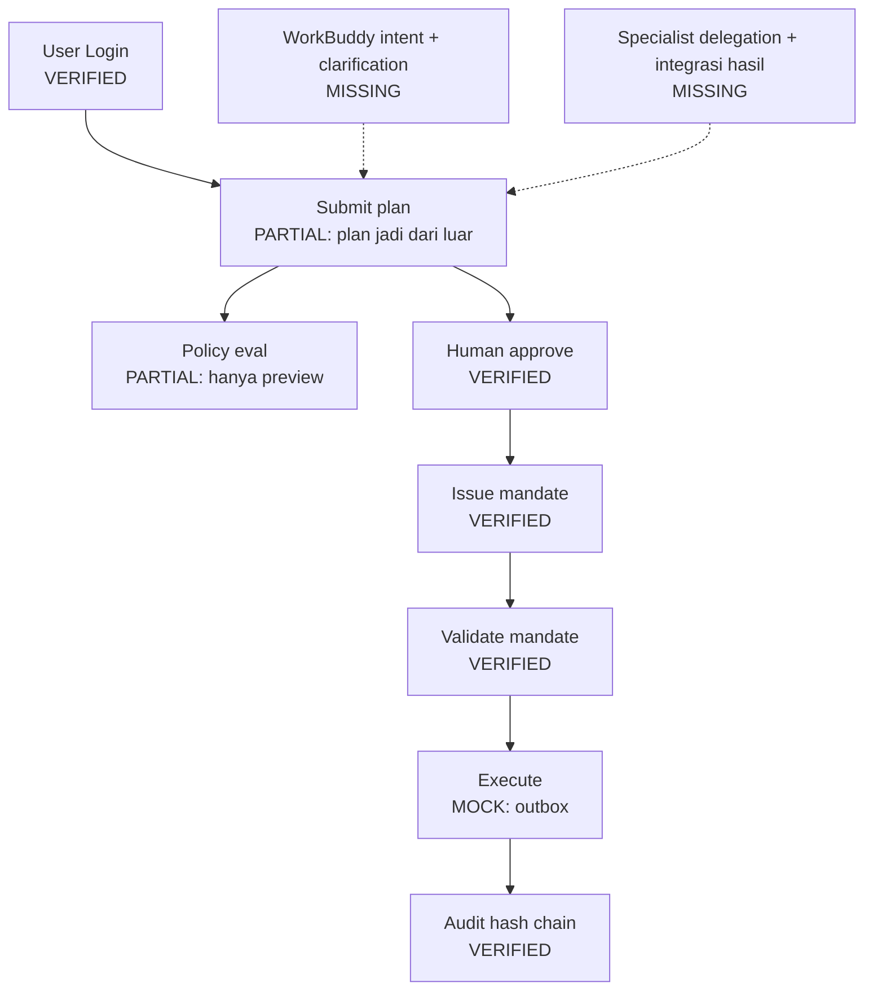
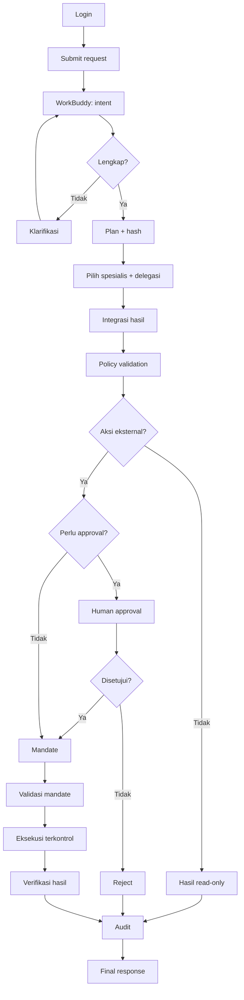

# DEXTRA — Master Context & System Architecture

> **Status dokumen:** sumber konteks untuk AI coding agent, AI designer, dan AI
> video/presentasi. Ditulis ulang agar sesuai **kondisi repository ini**, bukan
> aspirasi. Terakhir diverifikasi: **2026-11-08**, basis commit `e39492e`.
>
> **Aturan pakai:** dokumen ini menjelaskan *maksud sistem* dan *apa yang
> benar-benar ada*. Untuk detail kontrak, kode tetap menang atas dokumen ini.
> Jika kode berubah, perbarui [`docs/architecture/implementation-status.md`](docs/architecture/implementation-status.md)
> dan dokumen ini bersamaan.

---

## 0. Ringkasan satu paragraf

DEXTRA adalah **Governed Enterprise AI Workforce & Operations Platform**: lapisan
koordinasi di atas pekerjaan operasional perusahaan, tempat WorkBuddy memahami
permintaan, menyusun rencana, mendelegasikan ke spesialis, lalu **governance
deterministik** memutuskan apakah tindakan boleh dijalankan. Membaca boleh
otomatis selama permission mengizinkan; **menulis ke sistem eksternal wajib
melewati plan → policy → approval → mandate → eksekusi terkontrol → audit**.
DEXTRA bukan chatbot berpersona banyak, bukan ERP, dan bukan sekadar dashboard.

---

## 1. Identitas produk

**Tagline:** *Specialized AI workers. Human-defined authority. Accountable execution.*

**Prinsip inti:** `Baca boleh otomatis, tulis harus lewat mandat.`

Yang membedakan DEXTRA:

| Sistem biasa | DEXTRA |
| --- | --- |
| Chatbot menjawab pertanyaan | Orkestrasi pekerjaan yang terstruktur |
| Satu AI mengerjakan semuanya | Delegasi ke spesialis yang terdaftar |
| AI diberi akses langsung | Akses mengikuti capability + policy |
| Eksekusi sulit dilacak | Setiap langkah masuk audit chain |
| Approval = klik konfirmasi | Approval = mandate ber-scope, ber-expiry, bisa dicabut |
| Integrasi = sambung API | Integrasi = adapter di balik gerbang governance |

**Bukan:** chatbot generik, ERP pengganti, kumpulan persona, otomatisasi tanpa
persetujuan manusia.

**Tiga hal yang tidak boleh tertukar:**

1. **Intelligence** — WorkBuddy + AI workforce: memahami, merencanakan, memilih
   spesialis, menyatukan hasil.
2. **Authority** — governance engine deterministik: siapa boleh apa, kapan perlu
   approval, tindakan apa yang sah.
3. **Accountability** — execution + audit: apa yang dijalankan, hasilnya, dan
   buktinya.

---

## 2. Kondisi nyata repository

### 2.1 Stack aktual

| Area | Kenyataan di repo |
| --- | --- |
| Monorepo | pnpm workspace + Turborepo (`pnpm-workspace.yaml`, `turbo.json`) |
| `apps/web` | Next.js 16 (App Router, **webpack**), React 19, Tailwind 4. Port **3000** |
| `apps/api` | **FastAPI (Python ≥3.11)** + SQLAlchemy 2 + Alembic. Uvicorn port **8000** di Docker |
| `apps/worker` | Hanya kerangka Python (`main.py`) — belum ada consumer/queue |
| DB | SQLite untuk dev (`data/dextra.db`); PostgreSQL target produksi |
| Auth | Cookie session (HttpOnly) + CSRF double-submit + MFA TOTP + bearer token gateway |
| Governance | `apps/api/app/governance/{policy,approval,mandate}.py` |
| Audit | Append-only hash chain (`apps/api/app/repositories/audit.py`) |
| MCP | `apps/api/app/mcp/registry.py` = **peta tool→capability saja**, belum ada server transport |
| AI provider | **Belum ada** klien LLM di backend. Tidak ada Gemini/OpenAI terpasang |
| Package TS | Sebagian besar masih kontrak/interface (`ai-core`, `agent-runtime`, `workflow-engine`, dst.) |

**Penting:** meskipun `packages/*` TypeScript berisi kontrak "Intelligence Layer",
sumber kebenaran runtime hari ini adalah **`apps/api`**. Jangan menganggap
`packages/agent-runtime` sudah menjalankan agent — ia baru berisi tipe dan
interface.

### 2.2 Cara menjalankan

```bash
# Frontend
pnpm install
pnpm --filter @dextra/web dev          # http://localhost:3000

# Backend (dari root; butuh Python 3.11+)
uv run --with fastapi --with uvicorn --with sqlalchemy --with alembic --with pydantic \
  python -m uvicorn app.main:app --app-dir apps/api --port 8000

# Test backend (SQLite sementara)
uv run --with fastapi --with sqlalchemy --with alembic --with pydantic --with pytest --with httpx \
  python -m pytest apps/api/tests -q

# Gate monorepo
pnpm typecheck && pnpm lint && pnpm test
```

Port & URL yang benar hari ini: web `3000`, api `8000`, proxy web meneruskan ke
`DEXTRA_API_URL` (lihat `vercel.json`, `infrastructure/docker/docker-compose.yml`).
`.env.example` masih menyebut `API_URL=http://localhost:4000` — **stale**, jangan
diikuti tanpa memeriksa `apps/web/src/app/api/[...proxy]/route.ts`.

### 2.3 Hubungan dengan repo referensi

Ada dua repo publik:

| Repo | Isi | Hubungan |
| --- | --- | --- |
| `frzz969/DEXTRA` | Referensi lengkap: `backend/dextra` (FastAPI v2), 15 package TS (store, plan, policy-engine, mandate-engine, executor, office-agent, audit-export, dll.), `apps/mcp-server` (JSON-RPC gateway), 12 revisi Alembic, 60+ docs | Sumber untuk porting komponen yang belum ada |
| `frzz969/DEXTRA-OFFICE-AGENT` | Repo ini | Restrukturisasi dari `DEXTRA` |

Temuan terukur: **89 dari 93 file `apps/api/app` identik byte-per-byte** dengan
`backend/dextra` di referensi. Jadi backend Python **bukan** yang tertinggal.
Yang belum diport adalah lapisan TypeScript/operasional:

| Komponen referensi | Status di repo ini |
| --- | --- |
| `packages/contracts/src/authorization.ts` | **dipulihkan** (2026-11-08) — tes paritas lulus (21 tes) |
| `apps/mcp-server/` (JSON-RPC 127.0.0.1:8765, origin policy, 22 tool) | **hilang**; hanya `apps/api/app/mcp/registry.py` (allowlist tanpa transport) |
| `packages/{store,plan,policy-engine,mandate-engine,executor,office-agent,audit-export,replay,alerts,skill-registry,workflow,api-client}` | **hilang** (diganti skeleton tipis) |
| `packages/office-agent` (intake → decompose → clarify → policy → plan → validator) | **hilang**; backend hanya menerima plan jadi |
| `apps/worker` | kerangka; referensi pun hanya maintenance (expire mandate, fail stuck execution) |
| `scripts/` dev/migrate/test | hanya `scripts/check-env.mjs` |
| `workbuddy/agents/` | **repo ini lebih kaya** (4 persona domain); referensi tidak punya |

Konsekuensi: **jangan porting FastAPI lagi** — sudah selesai. Prioritas porting
ada di kontrak TS, MCP gateway, office-agent pipeline, dan audit export.

### 2.4 Struktur direktori yang bermakna

```text
apps/web        Next.js: landing, auth page, 15 halaman dashboard
apps/api        FastAPI: 23 router, governance, MCP registry, tests
apps/worker     kerangka eksekusi async (belum dipakai)
packages/       contracts, shared, config, governance, ai-core, agent-runtime,
                agent-registry, workflow-engine, auth, integrations,
                notifications, analytics, database, ui, design-system
workbuddy/      paket persona/team untuk AI host eksternal (WorkBuddy/CodeBuddy)
workflows/      contoh definisi workflow (belum dieksekusi runtime)
data/           runtime: SQLite + outbox (.eml/.ics/.task.json)
docs/           arsitektur, modul, agent, ADR, status implementasi
```

---

## 3. Arsitektur: tiga lapisan, satu rantai keputusan

```text
USER (Admin/Manager/Operator/Approver/Auditor)
  │  cookie session / bearer token
  ▼
apps/web  (presentasi + panggilan API; TIDAK menyimpan business logic)
  │  /api/[...proxy] → DEXTRA_API_URL
  ▼
apps/api  (FastAPI)
  ├── core/security      identitas, capability, tenant
  ├── modules/*          auth, tasks, approvals, mandates, execution,
  │                      policies, audit, workforce, office-agent, ...
  ├── governance/        policy (murni) · approval · mandate
  ├── workflow/          sequencer deterministik (noop/approval_gate/execute)
  ├── repositories/      audit hash chain
  └── mcp/registry       peta tool → capability (belum ada transport)
  ▼
SQLite/PostgreSQL  +  data/outbox (adapter "outbox")
```

### 3.1 Batas tanggung jawab yang tidak boleh dilanggar

| Komponen | Boleh | Tidak boleh |
| --- | --- | --- |
| `apps/web` | render state, panggil API, tampilkan status | memutuskan izin, membuat hash plan, mengarang audit |
| WorkBuddy / AI host | memahami intent, menyusun plan, delegasi | menerbitkan mandate, menyetujui plan sendiri, menulis DB langsung |
| `governance/policy.py` | keputusan deterministik | memanggil LLM/jaringan |
| `governance/mandate.py` | terbitkan/validasi/cabut mandate | mengeksekusi aksi |
| `modules/execution` | jalankan aksi ber-mandate | mengeksekusi tanpa mandate valid |
| `repositories/audit.py` | append + verifikasi chain | update/delete entri |

**Larangan arsitektur:** `apps/*` → boleh impor `packages/*`. `packages/*` tidak
boleh impor `apps/*`. `governance` tidak boleh bergantung pada domain bisnis.

---

## 4. WorkBuddy, spesialis, dan Policy Validator

### 4.1 WorkBuddy

WorkBuddy adalah **orchestrator**: menerima instruksi, memahami intent, meminta
klarifikasi bila ambigu, menyusun plan terstruktur, memilih spesialis, menyatukan
hasil, dan menyerahkan tindakan sensitif ke governance.

**Kondisi hari ini — jujur:**

- Backend **belum punya** endpoint intake permintaan bebas (`POST /requests`),
  belum ada klien LLM, belum ada state `needs_clarification`, belum ada loop
  klarifikasi, dan belum ada pemanggilan spesialis.
- Yang ada: `POST /api/v1/office-agent/plans` yang **menerima plan yang sudah
  jadi** dari luar (mis. worker/Office Agent), lalu approval → mandate →
  execution. Plan-nya dibuat di luar repo ini.
- Karena itu, klaim "WorkBuddy berjalan" hanya sah bila yang dimaksud adalah
  alur plan-ingest di atas.

### 4.2 Spesialis runtime (yang benar-benar terdaftar)

Empat slug di `apps/api/app/modules/workforce/router.py:25-30`:

| Slug | Peran |
| --- | --- |
| `workforce-dispatcher` | mengarahkan/mengoordinasikan pekerjaan |
| `executive-assistant` | pekerjaan sekretariat/administrasi eksekutif |
| `administrative-officer` | pekerjaan administratif |
| `adversarial-reviewer` | meninjau risiko/kelemahan rencana |

Mereka ada sebagai **baris `Agent` hasil seed** + konstanta registry. **Tidak ada
runtime yang memanggil mereka.** `list_agents` juga melaporkan `unexpected` untuk
slug di luar empat ini — jangan menambah slug tanpa implementasi.

### 4.3 Domain bisnis (arah produk, bukan runtime agent)

`workbuddy/agents/` berisi persona domain: Finance, HR, Inventory, Operations
(Operations = koordinasi lintas domain). Ini adalah **paket persona untuk AI host
eksternal**, bukan service yang berjalan di `apps/api`.

Aturan:

- Jangan menghapus empat spesialis runtime demi empat domain bisnis.
- Jangan mengganti nama komponen backend sembarangan.
- Jangan mengklaim Finance/HR/Inventory/Operations "terintegrasi penuh" tanpa
  endpoint dan adapter nyata. Hari ini backend **belum punya** endpoint
  `employees`, `leave`, `payroll`, `ledger`, `budget`, `purchase`, `reports`.

### 4.4 Policy Validator

Komponen **deterministik**, bukan agent kelima. `apps/api/app/governance/policy.py`
murni: input sama → keputusan sama, tanpa model, tanpa jaringan, waktu sebagai
argumen. Reason code dijaga sama dengan `packages/policy-engine/src/rules.ts`.

**Cacat yang harus diketahui:** engine ini saat ini hanya dipanggil oleh
`POST /policies/evaluate` (preview), **tidak** oleh jalur plan/approval/mandate/
execution. Artinya policy belum menjadi gerbang, baru alat peraga.

---

## 5. Lifecycle end-to-end (flowchart) vs kenyataan

Legenda status: **VERIFIED** (ada + diuji/dibuktikan kode) · **PARTIAL** (ada
sebagian) · **MOCK** (ada tapi tidak menyentuh dunia nyata) · **MISSING**.

| # | Node flowchart | Status | Bukti / catatan |
| --- | --- | --- | --- |
| 1 | User Login | **VERIFIED** | `modules/auth/router.py:261-393`; cookie HttpOnly + CSRF + MFA; tenant dari sesi/token, bukan klien |
| 2 | Submit Request | **PARTIAL** | Tidak ada `POST /requests`. Hanya `POST /office-agent/plans` yang menerima plan jadi |
| 3 | WorkBuddy: Understand Intent | **MISSING** | Tidak ada klien LLM/klasifikasi intent di backend |
| 4 | Complete? → Ask Clarification | **MISSING** | Tidak ada status `needs_clarification` maupun protokol pertanyaan |
| 5 | Create Execution Plan | **PARTIAL** | Plan disimpan apa adanya; `plan_hash` klien diterima tanpa verifikasi (`office_agent/router.py:120`) |
| 6 | Select Specialists / Delegate | **PARTIAL** | Registry + seed ada; tidak ada pemanggilan/delegasi runtime |
| 7 | Integrate Results | **MISSING** | Output per-step hanya ditumpuk di `state_json`; tidak ada agregator |
| 8 | Policy Validation | **PARTIAL** | Engine murni ada, tapi tidak dipanggil di jalur plan/approval/execution |
| 9 | External Action? (read vs write) | **MISSING** | Tidak ada model klasifikasi aksi; semua aksi diperlakukan sama |
| 10 | Approval Required? / Human Approval / Reject | **VERIFIED** (tanpa keputusan "perlu approval?") | `modules/approvals/router.py:60-95`, `office_agent/router.py:184-242`; approver = principal terverifikasi; self-approval service token ditolak |
| 11 | Issue + Validate Mandate | **VERIFIED (caveat)** | `governance/mandate.py`; params digest, action binding, expiry, revocation, tenant dicek saat eksekusi. Caveat: `nonce` dibuat tapi tidak dikonsumsi; `resource_scope`/`recipient_scope` disimpan tapi tidak ditegakkan; `plan_hash` tidak dibandingkan ke plan tersimpan |
| 12 | Controlled Execution | **MOCK** | `ADAPTER_NAME="outbox"` → tulis `.eml`/`.ics`/`.task.json` ke `data/outbox`. Bug: `send_email`/`create_calendar_event` tidak cocok string `email`/`calendar` sehingga jatuh ke adapter task |
| 13 | Verify Result | **PARTIAL** | "Verify" = status tulis file adapter; tidak ada read-back/verifikasi efek |
| 14 | Append Audit Evidence | **VERIFIED** | `repositories/audit.py` append-only + hash chain + `verify_chain`; tidak ada API update/delete. Caveat: satu chain global lintas tenant; `/audit-events/verify` tidak difilter tenant |
| 15 | Final Response | **PARTIAL** | Mengembalikan status eksekusi JSON + hint next step; tidak ada jawaban akhir tersusun untuk pemohon |

**Kesimpulan:** tulang punggung governance (approval → mandate → eksekusi →
audit) **nyata dan teruji**, tetapi **belum tersambung** ke plan/policy, dan
belum ada WorkBuddy. Yang belum ada bukan "sedikit": node 3, 4, 7, 9 hilang;
node 8 dan 12 belum berfungsi sebagai gerbang/efek nyata.

### 5.1 Diagram alur yang benar untuk kondisi sekarang



### 5.2 Satu siklus yang diinginkan (target)



---

## 6. Invariant governance (tidak boleh dilanggar)

1. **Identitas dari server.** `tenant_id` dan capability dihitung dari sesi/token,
   tidak pernah dari body. Tanpa tenant → `scope_to_tenant` menghasilkan `false()`
   (kosong), bukan "semua data".
2. **Plan ≠ mandate.** Plan adalah niat; mandate adalah izin eksekusi terbatas.
3. **Mandate terikat** pada `action_id` + `params_hash` (SHA-256 kanonik), punya
   `expires_at`, bisa dicabut, dan tidak bisa dipakai lintas tenant.
4. **Validasi ulang tepat sebelum eksekusi**, bukan hanya saat approval.
5. **Approver tidak boleh menyetujui dirinya sendiri** (khususnya service token /
   agent). Keputusan approval selalu atas principal terverifikasi.
6. **Idempotensi**: plan per `request_id`; eksekusi per
   `mandate_id:action_id:params_digest`; workflow per `idempotency_key`.
7. **Audit append-only** dengan hash chain; perubahan baris lama harus terdeteksi.
8. **Tidak ada jalur bypass**: tidak ada endpoint yang menulis ke adapter tanpa
   mandate; tidak ada CORS wildcard; tidak ada "agent mode" khusus.
9. **Status adapter ≠ bukti efek.** `succeeded` dari outbox hanya berarti file
   tertulis, bukan email diterima.

---

## 7. Frontend: kondisi nyata

**Verdict: UI belum tersambung ke API.** Satu-satunya `fetch` di `apps/web/src`
adalah proxy `app/api/[...proxy]/route.ts`. Semua halaman dashboard membaca
fixture `src/data/mock-store.ts` lewat `providers/dextra-provider.tsx`.

| Halaman | Sumber data |
| --- | --- |
| `/overview`, `/tasks`, `/operations`, `/agents`, `/hr`, `/finance`, `/inventory`, `/analytics`, `/reports` | mock |
| `/ai-workspace` | simulasi `setTimeout` (`runWorkBuddyPrompt`), approval ID palsu `APR-1050` |
| `/approvals`, `/governance`, `/audit-logs`, `/integrations` | mock; hash audit dibuat acak di klien |
| `/settings` | `useState` lokal, tidak lewat provider |
| `/login`, `/register` | tidak memanggil API; langsung `router.push('/overview')` |
| `/` (landing) | statis, berlabel "Mode demo" |

Konsekuensi: **jangan** mengklaim UI menampilkan eksekusi nyata. Untuk wiring,
dibutuhkan: klien API + hook, login nyata (`POST /api/v1/auth/login`), CSRF token,
reshaping DTO (`@dextra/contracts` sekarang berisi DTO demo, bukan DTO API), dan
endpoint domain HR/Finance/Inventory/Reports yang belum ada.

Backend yang sudah siap dipakai UI tetapi belum dipanggil: `/overview`, `/agents`,
`/tasks`, `/approvals`, `/mandates`, `/policies`, `/audit-events`,
`/integrations/status`, `/analytics/daily`, `/settings`, serta alur
`office-agent/plans → approve → mandate → executions`.

---

## 8. Integrasi & execution

- Executor hari ini: **adapter `outbox`**. File `.eml`, `.ics`, `.task.json` di
  `data/outbox`. Tidak ada SMTP/Graph/Google.
- `POST /executions` memerlukan `mandate_id` + `action_id` + `params`.
- Adapter harus diberi **kontrak + capability + audit**, bukan ditambahkan
  sebagai cabang `if` liar. Setiap adapter baru wajib punya: auth, scope tenant,
  validasi input, error handling, idempotensi, verifikasi hasil, bukti audit.
- Integrasi target (belum ada): email, calendar, HRIS, finance, inventory, task
  management, document storage, WhatsApp, Telegram.

---

## 9. Keamanan

Sudah ada: scrypt password, MFA TOTP (secret terenkripsi), sesi cookie
HttpOnly + idle/absolute timeout, CSRF double-submit, throttling login,
bearer token gateway dengan capability terbatas, tenant scoping di repository,
CORS allowlist, audit chain.

Yang perlu dijaga saat mengubah kode:

- Jangan menambah endpoint yang melewatkan `require_capability` / `require_tenant`.
- Jangan menaruh secret di `NEXT_PUBLIC_*` atau body request.
- Jangan mencatat token/kredensial ke log.
- Jangan mempercayai `plan_hash`, `action_type`, atau `params` dari klien tanpa
  verifikasi/normalisasi.

---

## 10. Ledger status jujur (per 2026-11-08)

| Area | Status | Bukti |
| --- | --- | --- |
| Auth sesi + MFA + CSRF | VERIFIED | tests `test_auth_flow.py` |
| Tenant isolation | VERIFIED | `core/authz.py`, tests isolasi |
| Approval + mandate + revoke | VERIFIED | `test_governance_flow.py` |
| Audit hash chain | VERIFIED | `test_audit_chain_versioning.py` |
| Idempotensi eksekusi | VERIFIED | `test_governance_flow.py:89-117` |
| Policy di jalur keputusan | PARTIAL | evaluasi dijalankan saat approval (`approval.py`), deny → PolicyDenied; tetapi aksi read-only belum dievaluasi dan `/approvals` jalur langsung sudah menangkap PolicyDenied |
| Plan↔approval binding | **PARTIAL** | `plan_hash` diverifikasi di `office_agent/submit_plan`; approval masih mempercayai `params` klien (belum diverifikasi ke plan tersimpan) |
| WorkBuddy / intent / klarifikasi | MISSING | tidak ada klien LLM |
| Delegasi spesialis | PARTIAL (registry only) | `workforce/router.py:25-30` |
| Integrasi hasil | MISSING | tidak ada agregator |
| Eksekusi eksternal nyata | MOCK | outbox |
| Verifikasi efek | PARTIAL | status adapter saja |
| MCP server | MISSING | hanya `mcp/registry.py` |
| Web ↔ API | MISSING | mock store |
| `apps/worker` | MISSING | kerangka |
| CI Python | PARTIAL | `continue-on-error` |

**Aturan kejujuran:** setiap fitur harus diklasifikasikan salah satu dari
`IMPLEMENTED AND VERIFIED` / `IMPLEMENTED, NOT VERIFIED` / `PARTIAL` / `MOCK` /
`NOT IMPLEMENTED` / `ROADMAP`. Jangan pernah melaporkan mock sebagai live.

---

## 11. Backlog prioritas (berdasarkan bukti, bukan selera)

**P0 — menutup lubang governance (paling berbahaya sekarang)**

1. Verifikasi `plan_hash` dan `params` terhadap `OfficePlanRequest` saat approval;
   tolak bila tidak cocok.
2. Panggil `governance/policy.evaluate()` di jalur plan/approval; `deny` → 422,
   `review` → wajib approval manusia, `allow` → boleh lanjut.
3. Konsumsi `nonce` mandate (sekali pakai) dan tegakkan `resource_scope` /
   `recipient_scope` saat eksekusi.
4. Klasifikasi aksi eksplisit: `read_only` vs `state_changing` (dan peta
   `action_type` → adapter), agar `send_email` tidak diam-diam jadi task.
5. Filter tenant pada `/audit-events/verify` atau pisahkan chain per tenant.

**P1 — WorkBuddy yang nyata**

6. `POST /requests` (intake) + state `needs_clarification` + `POST /requests/{id}/answers`.
7. Orkestrator deterministik: plan builder, pemilihan spesialis berbasis aturan,
   agregasi hasil. LLM opsional di belakang interface `ai-core`, tidak boleh
   memutuskan izin.
8. Delegate spesialis yang benar-benar tercatat di audit (bukan sekadar baris DB).

**P2 — efek nyata & UI**

9. Adapter email/calendar sungguhan (atau adapter "simulated" berlabel jelas)
   + verifikasi hasil.
10. Klien API web + login nyata + wiring approvals/mandates/audit/agents.
11. Endpoint domain HR/Finance/Inventory/Reports sebelum halamannya diklaim live.
12. MCP server transport (stdio/HTTP) yang memakai `mcp/registry.py`.

---

## 12. Master instruction untuk AI agent

### A. Sebelum menulis kode

1. Baca `AGENTS.md`, `design.md`, `docs/architecture/overview.md`,
   `docs/architecture/implementation-status.md`, dan dokumen ini.
2. Periksa kode yang benar-benar ada; jangan percaya dokumen/laporan lama.
3. Identifikasi package/modul penanggung jawab dan dependency-nya.
4. Lacak lifecycle yang terdampak (auth → request → plan → policy → approval →
   mandate → execution → audit).
5. Tulis dampak keamanan: tenant, capability, idempotensi, audit.

### B. Saat menulis kode

- Satu sumber kebenaran per domain; jangan menduplikasi business logic.
- Governance ditegakkan di backend, bukan dengan menyembunyikan tombol.
- Jangan menambah jalur tulis baru tanpa mandate.
- Jangan membuat agent fiktif, endpoint palsu, atau angka analytics karangan.
- Perubahan skema DB harus lewat Alembic di `packages/database`, bukan
  `create_all` di produksi.
- Pertahankan bahasa Indonesia pada UI dan pesan error yang sudah ada.

### C. Setelah menulis kode

- Jalankan tes yang relevan, lalu gate penuh sekali di akhir:
  `pnpm typecheck && pnpm lint && pnpm test` dan `pytest apps/api/tests`.
- Uji jalur nyata yang terdampak, bukan hanya build sukses.
- Uji isolasi tenant dan otorisasi untuk setiap endpoint baru.
- Laporkan file yang berubah, hasil tes aktual, dan limitasi yang tersisa.

### D. Yang dilarang

- Mengklaim integrasi aktif tanpa adapter yang diuji ke tujuan sebenarnya.
- Mengklaim email terkirim karena file outbox tertulis.
- Menghapus empat spesialis runtime atau mengganti nama slug backend.
- Menaruh logika izin di frontend.
- Membuat microservice/paket baru tanpa alasan kuat.
- Menandai fitur "selesai" tanpa bukti.

---

## 13. Glosarium

| Istilah | Arti |
| --- | --- |
| Plan | representasi terstruktur pekerjaan (bukan izin) |
| Plan hash | SHA-256 kanonik atas actions; identitas integritas plan |
| Policy | aturan deterministik yang menentukan boleh/tidak |
| Review | keputusan policy yang memaksa approval manusia |
| Approval | keputusan manusia atas satu aksi |
| Mandate | izin eksekusi terbatas: aksi, params hash, scope, expiry, revocable |
| Capability | izin teknis yang diperiksa `require_capability` |
| Tenant | batas organisasi; semua query bisnis di-scope |
| Idempotency key | kunci anti-duplikasi eksekusi |
| Outbox | adapter tiruan yang menulis file, bukan mengirim |
| Audit chain | rantai hash append-only untuk deteksi manipulasi |
| MCP | protokol tool untuk AI host; di repo ini baru peta capability |
| WorkBuddy | AI host/orchestrator eksternal + paket persona di `workbuddy/` |

---

*Dokumen ini menggantikan `DEXTRA — Master Context` versi naratif. Jika ada
konflik antara dokumen ini dan kode, kode menang; perbaiki dokumennya.*
